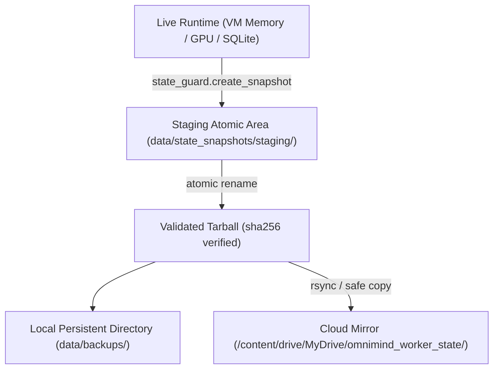

# Continuous Runtime, State Integrity & Checkpointing Audit

**Doc ID**: OW-AUD-EN-002  
**Project**: OmniMind / Omni-Worker Dual-Brain Architecture  
**Classification**: Technical Audit Summary [DATA][VERIFIED]  
**Date**: November 2026  
**License**: Apache-2.0  

---

## Executive Summary

This document synthesizes operational audits of continuous runtime services, SQLite database integrity, distributed event bus synchronization, and Google Drive state checkpointing for `omni_worker`. It verifies persistent state consistency across cold-start restarts and uncoordinated VM evictions.

---

## 1. Storage Inventory & Database Topology

The worker runtime coordinates multiple local SQLite stores running under WAL (Write-Ahead Logging) mode:

```
data/
├── memtrias.sqlite          # Episodic & semantic memory store (7 canonical namespaces)
├── mesh_store.sqlite        # Inter-agent mesh key-value & telemetry cache
├── node_db.sqlite           # Local identity, topology & node parameters
├── feedback_loop.sqlite     # Integration loop history & modulation vectors
├── diag_battery.sqlite      # Gemma-4 cognitive diagnostic evaluation records
├── supervisor_battery.sqlite# Affect tracer & supervisor verification transcripts
└── state_snapshots/         # Atomic tarballs verified by SHA-256 manifests
```

### Database Verification Summary:
- **WAL Journaling**: `PRAGMA journal_mode = WAL` and `PRAGMA synchronous = NORMAL` active across all SQLite connections, eliminating lock contention under concurrent dual-brain inference.
- **Foreign Key Enforcement**: Gated on connection open.
- **Memtrias Namespaces**: Over 250 verified empirical memory items structured across `document`, `instance`, `machine`, `interaction`, `state`, `user`, and `dream` partitions.

---

## 2. Checkpointing & Recovery Protocol

The worker employs a two-tier checkpointing and backup architecture:



### Safety Guarantees:
1. **Never Traverse Cloud Recursively**: Storage scripts avoid recursive directory traversals into `/content/drive` to eliminate cloud filesystem latency locks.
2. **Atomic Ingestion**: Restore operations unpack into a staging isolation directory first. If SHA-256 manifest verification fails, live state is untouched (fail-closed integrity).

---

## 3. Frontend & Pulse Telemetry

The real-time operational dashboard ([dashboard.html](file:///content/omni_worker/docs/dashboard.html)) operates statelessly by fetching structured telemetry from `docs/data/dashboard/latest.json`.

- **Cadence**: Updated synchronously by `scripts/pulse_dashboard_sync.sh`.
- **Observed Metrics**:
  - Somatic: CPU %, RAM GB, GPU VRAM usage, PSI I/O and Memory pressure.
  - Cognitive: Dual-model active status (`:8098` / `:8099`), attention entropy, token generation throughput.
  - Trust: Circuit breaker failure counters and component quarantine rosters.
