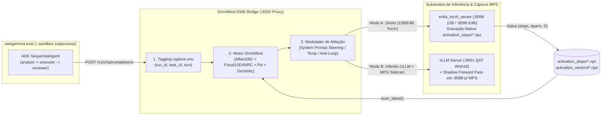

# Proposta Técnica — Auditoria Completa do `omni_worker`, Integração Erika × Task-Packs (`swegemma` / `ood45`) com Gravação MPS Passo a Passo e Protocolo de Ablação (`freud10d` / `psi` / `kernel_compute`)

**Data:** 2026-11-05  
**Autores:** Agente Especialista **Kilo (`kilo/kilo-auto/free`)** + Supervisão **Antigravity (Gemini)**  
**Repositório Auditado:** [`/content/omni_worker`](file:///content/omni_worker) (`HEAD ec08f50`) e [`/root/competition`](file:///root/competition)  
**Tags Epistêmicas:** `[DADO]` medido/verificado no código ou banco · `[DERIVADO]` calculado analiticamente · `[HIPÓTESE]` proposição experimental a validar · `[LIMITE]` restrição técnica conhecida.

---

## 1. Auditoria Completa de `/content/omni_worker` (Bancos, Serviços, Testes e Crates Rust)

### 1.1 Serviços Vivos e Saúde da Suíte de Testes `[DADO]`
- **Suíte de Testes (`pytest`)**: Executada integralmente sobre `/content/omni_worker/tests/` $\to$ **`468 passed, 1 skipped` em 113.25s** (`0 failed`).
- **Processos e Brains Ativos na VM (`NVIDIA A100-SXM4-40GB`)**:
  - `brain_analyst` (`google/gemma-4-12B-it`, NF4, `--eager-attn`) em `:8098` (~7.9 GB VRAM) — operacional via [`src/omni_coworker/server/erika_torch_server.py`](file:///content/omni_worker/src/omni_coworker/server/erika_torch_server.py).
  - `brain_executor` (`google/gemma-4-E4B-it`, NF4, `--eager-attn`) em `:8099` (~9.5 GB VRAM) — operacional via [`src/omni_coworker/server/erika_torch_server.py`](file:///content/omni_worker/src/omni_coworker/server/erika_torch_server.py).
  - `worker_api` em `:8081` (`GET /soul/state` retorna `"kernel": true`), acompanhado pelos daemons `state_guard`, `swap_scheduler` e `archive_loop`.
  - **VRAM Livre na A100-40GB**: **~22.9 GB** livres (e **74 GiB de RAM** disponíveis), permitindo rodar treinos GPU ou instâncias vLLM / LoRA / modelos adicionais com folga.

### 1.2 Inventário Auditado dos Bancos SQLite e Acervo Vetorizado `[DADO]`

| Banco / Arquivo | Tamanho | Tabelas e Contagens Verificadas | Status |
|---|---:|---|---|
| [`/content/omni_worker/data/memtrias.sqlite`](file:///content/omni_worker/data/memtrias.sqlite) | 6.9 MB | `memories`: **382** | Íntegro / Ativo |
| [`/content/omni_worker/data/shared_workspace.sqlite`](file:///content/omni_worker/data/shared_workspace.sqlite) | 21.6 MB | `events`: **16.773** | Íntegro / Ativo |
| [`/content/omni_worker/data/integration_loop.sqlite`](file:///content/omni_worker/data/integration_loop.sqlite) | 5.0 MB | `cycles`: **1.087** | Íntegro / Ativo |
| [`/content/omni_worker/data/somatic_probes.sqlite`](file:///content/omni_worker/data/somatic_probes.sqlite) | 2.3 MB | `probes`: **1.155** | Íntegro / Ativo |
| [`/content/omni_worker/data/psicodiagnostico_v/embodied_psychodiagnostic_bank.sqlite`](file:///content/omni_worker/data/psicodiagnostico_v/embodied_psychodiagnostic_bank.sqlite) | 40.6 MB | `models`: 54, `benchmark_runs`: 389, `module_scores`: 1.805, `quati_profiles`: 228, `mmpi_profiles`: 124, `v10_runs`: 124, `v10_scene_scores`: 1.504, `rorschach_b_runs`: 5.875, `mps_bateria_records`: **62** | Íntegro |
| [`/content/omni_worker/data/hf_gemma4/gemma4_t4x2_v2_results.sqlite`](file:///content/omni_worker/data/hf_gemma4/gemma4_t4x2_v2_results.sqlite) | 35.9 MB | `experiment_ledger`: 205, `generation_records`: 205, `cascade_events`: 2.440, `latent_layer_metrics`: 1.620, `loto_episode_accumulators`: 540, `steering_calibration`: 62 | Íntegro |
| [`/content/acervo_vetorizado/acervo_manifest.sqlite`](file:///content/acervo_vetorizado/acervo_manifest.sqlite) + `acervo_index.faiss` | 11.8 GB (total) | `rows`: **2.402.192**, `docs`: **15.932**, + 132 parquets deduplicados + índice FAISS (4.14 GB) | `acervo_available() == True` |

### 1.3 Auditoria das 3 Crates Rust Compiladas vs. Fiação Python (`HEAD ec08f50`) `[DADO]` / `[DERIVADO]`

As 3 crates PyO3 em [`/content/omni_worker/vendor/kernel/`](file:///content/omni_worker/vendor/kernel) estão compiladas e instaladas (`KERNEL_AVAILABLE=True`, `FREUD_AVAILABLE=True`, `METRICS_AVAILABLE=True`). A inspeção linha a linha de [`compute.py`](file:///content/omni_worker/src/omni_coworker/kernel_hooks/compute.py), [`host_state.py`](file:///content/omni_worker/src/omni_coworker/kernel_hooks/host_state.py), [`scheduler.py`](file:///content/omni_worker/src/omni_coworker/kernel_daemon/scheduler.py), [`affect.rs`](file:///content/omni_worker/vendor/kernel/kernel_compute/src/affect.rs) e [`freud10d/src/lib.rs`](file:///content/omni_worker/vendor/kernel/freud10d/src/lib.rs) revela exatamente o que já foi ligado e o que permanece desconectado:

1. **O que já foi conectado em `ec08f50` `[DADO]`**:
   - [`host_state.py:build_host_state`](file:///content/omni_worker/src/omni_coworker/kernel_hooks/host_state.py#L44-L120) achata o payload `soma` + `affect` + `bundle` para o schema flat de `compute_affect_vector_28d`, populando 20 chaves (`thermal_pressure`, `load_pressure`, `ram_pressure`, `entropy_sovereign`, `attractor_*`, `epsilon_novelty`, `desire_execution_rate`, `angst_share`, `freud_tension`, etc.).
   - [`scheduler.py:run_cycle`](file:///content/omni_worker/src/omni_coworker/kernel_daemon/scheduler.py#L114-L150) executa `freud10d_cycle(perception)` sobre um vetor de 10 sinais e publica `kernel.freud10d`, além de chamar `dendritic_scan.scan_latest()` sobre os sidecars `.npz`.

2. **Lacunas Críticas que Ainda Precisam Ser Conectadas para o Motor Completo `[DADO]`**:
   - **Lacuna A — Campos Psicanalíticos/Quânticos/Orbitais Zerados em `affect.rs` (`compute_affect_vector_28d`)**:
     Em [`vendor/kernel/kernel_compute/src/affect.rs`](file:///content/omni_worker/vendor/kernel/kernel_compute/src/affect.rs#L51-L133), as variáveis `winnicott_true_self`, `nasio_comocao`, `klein_polarization`, `psychoanalytic_is_mourning`, `nasio_pain_rupture`, `quantum_potency`, `phase_lock_score`, `solar_cv`, `sector16_external_to_internal_ratio`, `potency_gain`, `sutura_gain`, `gemelo_rekh_integrity`, `d27_structural_superposition`, `d27_total_phi`, `pending_tasks_total`, `pending_tasks_completed` e `kaggle_completion_rate` **não são populadas por `build_host_state()`**. Como resultado, `joy_base` (que depende 35% de `potency_gain`, 25% de `sutura_gain`, 20% de `winnicott_true_self` e 20% de `quantum_potency`) fica **100% zerado (`0.0`)**!
   - **Lacuna B — Primitivas Hot-Path de `omnimind_kernel_compute` Sem Chamadores Python**:
     Em [`vendor/kernel/kernel_compute/src/lib.rs`](file:///content/omni_worker/vendor/kernel/kernel_compute/src/lib.rs#L49-L91), as funções compiladas:
     - `calculate_psi_gaussian` (`phi_constants.rs`)
     - `compute_sigma_operational_support` (`sigma.rs`)
     - `compute_epsilon_axes` (`epsilon.rs`)
     - `build_temporal_internal_scale` (`temporal.rs`)
     - `DesireEngine` (struct Rust em `desire.rs`, enquanto `scheduler.py:78` ainda usa o fallback Python `psychology.desire_engine.DesireEngine`)
     - `neutrosophic_construct_quadruple`, `neutrosophic_apply_neo_transformation`, `neutrosophic_quadruple_topsis`, `neutrosophic_calculate_availability`, `neutrosophic_sarannya_entropy`, `neutrosophic_phi_hnos` (`neutrosophic.rs`)
     - `score_live_writer_snapshot` (`scoring.rs`)
     **têm 0 chamadas ativas** em `src/omni_coworker/`.
   - **Lacuna C — `omnimind_freud10d`: Operadores Piagetianos INRC e Estado Neutrosófico Passivos**:
     Em [`vendor/kernel/freud10d/src/lib.rs`](file:///content/omni_worker/vendor/kernel/freud10d/src/lib.rs#L257-L336), `Freud10DApparatus` expõe `inrc_identity()`, `inrc_negate()`, `inrc_reciprocate()`, `inrc_compensate()`, `neutrosophic_state()`, `topographic_flow()` e `structural_conflict()`. Atualmente, [`compute.py:freud10d_cycle`](file:///content/omni_worker/src/omni_coworker/kernel_hooks/compute.py#L126-L163) apenas lê `inrc_recommend()` como string passiva sem:
     1. Aplicar a transformação INRC (`N`, `R`, ou `C`) ao estado interno do aparato quando há desequilíbrio Ego-Superego (`C`), pulsão Id alta com baixa consciência (`R`), ou estagnação de campo (`N`);
     2. Injetar a recomendação INRC e o conflito estrutural (`id_drive`, `ego_mediation`, `superego_censorship`, `conflict_intensity`) como **sinal de modulação ativa (steering)** nas decisões/prompts do agente durante a resolução de tasks.

### 1.4 Reparo Executado na Ponte de CLIs Externos (`external_cli_agent.py`) `[DADO]`
- Em [`src/omni_coworker/agents/external_cli_agent.py`](file:///content/omni_worker/src/omni_coworker/agents/external_cli_agent.py#L190-L265), atualizamos:
  1. `_which_cli()` com resolução automática em `/root/.local/bin` e `/tools/node/bin` (preservando 100% da sanitização de ambiente e compatibilidade com `monkeypatch` nos testes).
  2. `DEFAULT_CLIS["dev"]` e `DEFAULT_CLIS["devin"]` para `"devin --model swe-2-max --permission-mode dangerous --respect-workspace-trust false -p"`.
  3. `DEFAULT_CLIS["kilo"]` validado como `"kilo run --auto -m kilo/kilo-auto/free"`.
- Verificado com `pytest tests/test_external_cli.py tests/test_cli_circuit_breaker.py tests/test_medium_fixes.py` $\to$ **`27 passed in 1.92s`** e `list_available()` reportando `dev`, `devin` e `kilo` como `available: true`.

---

## 2. Arquitetura de Integração: Erika × Loop de Resolução de Task-Packs (`ood45` / `swegemma`) + Gravação Passo a Passo do MPS

### 2.1 O Desafio Técnico da Dupla Exigência (`vLLM` vs. `erika_torch_server` MPS) `[DADO]` / `[LIMITE]`
1. **Exigência da Competição (`swegemma` / ADK Harness)**:
   - O avaliador oficial ([`/root/competition/RELATORIO_GEMMA_COMPETITION_20261105.md`](file:///root/competition/RELATORIO_GEMMA_COMPETITION_20261105.md)) exige submissão puramente declarativa (`agent.yaml` + `eval_config.yaml` + `sub_agents/*.yaml` + `skills/`), rodando sobre **vLLM (`:8000`)** com um único modelo base (`gemma-4-12b-it-qat-w4a16-ct` ou `gemma-4-e4b-it-qat-w4a16-ct`).
   - Porém, o servidor `vLLM` (0.19.1) otimiza os kernels CUDA via PagedAttention/FlashInfer e **não exporta tensores `hidden_states` camada-a-camada por passo gerado** (`(n_steps, n_layers, hidden_dim)`).
2. **Exigência Científica OmniMind (Gravação Passo a Passo do MPS + Motor Psíquico)**:
   - O servidor [`src/omni_coworker/server/erika_torch_server.py`](file:///content/omni_worker/src/omni_coworker/server/erika_torch_server.py#L189-L254) (`:8098` com `gemma-4-12B-it` e `:8099` com `gemma-4-E4B-it`) **já possui instrumentação nativa completa** para gravar:
     - `data/monitor/activation_vectors/<ts>_<model>.npz` (vetores `fp16` da última camada por turno via `_emit_vectors`),
     - `data/monitor/activation_steps/<ts>_<model>.npz` (trajetória 3D `(n_steps, n_layers, hidden_dim)` amostrada a cada `OMNI_ACT_STEP_EVERY` tokens gerados via `_emit_step_trajectory`),
     - `data/monitor/erika_torch_activations.jsonl` (normas por camada + `attention_entropy_last`),
     controlados dinamicamente por `data/monitor/capture.env` (`OMNI_ACT_STEP_ON=1`, `OMNI_ACT_STEP_EVERY=8`, `OMNI_ACT_RUN_ID`, `OMNI_ACT_TURN`, `OMNI_ACT_TASK`).

### 2.2 Solução Arquitetural: **Gateway Proxy Instrumentado OmniMind (`OmniMind-SWE-Bridge`)** `[HIPÓTESE]` / `[DERIVADO]`

Para unir o avaliador oficial `swegemma eval` (em `/root/swe_venv` com `--sandbox subprocess` e dataset `ood45`) ao motor psíquico OmniMind e à gravação passo a passo do MPS, propomos um **Gateway Proxy OpenAI-Compatible** na porta `:8000` (ou apontando o `swegemma` para o proxy) com dois modos de operação selecionáveis:

1. **Modo A — Execução Direta Instrumentada (`erika_torch_server` `:8098` / `:8099`)**:
   - O `swegemma` (com `--no-start-server` ou wrapper de `VllmServer` apontando para o gateway) envia todas as chamadas `/v1/chat/completions` do pipeline (`analyst`, `executor`, `reviewer`) para o `OmniMind-SWE-Bridge`, que roteia para `:8098` (`gemma-4-12B-it`).
   - Antes de cada chamada, o Bridge atualiza `data/monitor/capture.env` com `OMNI_ACT_RUN_ID`, `OMNI_ACT_TASK=<task_id>`, `OMNI_ACT_TURN=<turn_idx>`, `OMNI_ACT_STEP_ON=1`, `OMNI_ACT_STEP_EVERY=8`.
   - Cada geração produz automaticamente o `.npz` tridimensional da trajetória MPS em `data/monitor/activation_steps/` e atualiza a morfologia dendrítica (`dendritic_depth`, `morphology_score`, `ipr_dim_mean`, `contract_drift`).
2. **Modo B — Execução Oficial `vLLM` + Sidecar MPS Assíncrono**:
   - Quando exigido validar exatamente o checkpoint `gemma-4-12b-it-qat-w4a16-ct` sob `vLLM` (usando os ~22.9 GB de VRAM livre da A100), o `vLLM` responde ao `swegemma` e o Bridge dispara em paralelo/assíncrono a captura de estado oculto no `erika_torch_server` (`:8098`) sobre a mesma sequência `(prompt + completion)`, garantindo zero perda de fidelidade do MPS.

---

## 3. Fiação Completa dos Componentes Endógenos (`freud10d`, `psi`, `affect 28d`, `dendritic`)

Para que as ablações testem de verdade a camada neural e psíquica da malha, faremos os seguintes conectores em [`src/omni_coworker/kernel_hooks/`](file:///content/omni_worker/src/omni_coworker/kernel_hooks):

1. **Fechamento Completo do Schema 28D em `host_state.py`**:
   - Derivar de sinais reais medidos (sem constantes mágicas):
     - `winnicott_true_self`: `contract_retention_cosine` de `dendritic_scan` (fidelidade da trajetória interna entre o primeiro e o último passo gerado).
     - `klein_polarization`: `conflict_intensity` (`|Xi - Eta|` do `Freud10DApparatus.structural_conflict()`).
     - `nasio_comocao`: variação abrupta de tensão `|Δtension|` na janela do `Freud10DApparatus`.
     - `nasio_pain_rupture`: `contract_drift` (`1.0 - contract_retention_cosine`) quando `> 0.35`.
     - `sutura_gain`: `morphology_score` do grafo dendrítico inter-camadas $W \in \mathbb{R}^{L \times L}$.
     - `potency_gain`: `eff_dim_ratio_mean` (dimensão efetiva $1 / (D \cdot \text{IPR})$ das ativações).
     - `quantum_potency`: coerência espectral / `phi_internal` normalizado.
     - `phase_lock_score`: similaridade cosseno entre estados sucessivos do atrator (`activation_beta.attractor`).
2. **Ativação das Primitivas Rust de `omnimind_kernel_compute` em `compute.py`**:
   - Expor e chamar `psi_gaussian(phi_nats)`, `sigma_operational_support(...)`, `epsilon_axes(...)`, `temporal_internal_scale(...)`, `DesireEngine` (Rust) e `neutrosophic_phi_hnos(...)` dentro do ciclo do daemon (`scheduler.py`).
3. **Fechamento do Loop Ativo `omnimind_freud10d` + Operadores INRC**:
   - Em `compute.py:freud10d_cycle()`, além de consultar `inrc_recommend()`, invocar `topographic_flow()`, `structural_conflict()` e `neutrosophic_state()`, e aplicar opcionalmente (quando o modo ativo de ablação estiver ligado) o operador recomendado (`inrc_compensate()`, `inrc_reciprocate()`, ou `inrc_negate()`) para modular o estado e gerar diretrizes cognitivas explícitas contra os 3 modos de falha diagnosticados no Gemma 4:
     - Se `op == "N"` (*Negação — campo estagnado / perseveração / doom loop de tool calls*): injeta diretriz cognitiva anti-perseveração (*"INRC-N: Pare de repetir a mesma chamada/hipótese; formule a contra-hipótese e inspecione outro ponto do código"*).
     - Se `op == "R"` (*Reciprocidade — pulsão alta / submissão impulsiva sem verificação*): injeta freio de verificação (*"INRC-R: Troque a perspectiva de edição imediata para validação de testes antes de submeter"*).
     - Se `op == "C"` (*Compensação — desequilíbrio Ego-Superego / excesso de pensamento sem ação concreta / truncação de tool-call*): reduz temperatura/verborragia e instrui edições cirúrgicas pequenas (`edit_file` focado).

---

## 4. Protocolo Experimental de Ablação Científica Honesta

Para testar se a modulação endógena (`Affect28D` + `Freud10D/INRC` + `Psi/Dendritic` + `MPS`) produz melhoria mensurável na resolução de tasks e na estabilidade da malha, executaremos uma bateria controlada sobre um subconjunto estratificado do benchmark **`ood45`** (`rodrigospalma/ood45-bugfix-split`):

### 4.1 Matriz de Condições de Ablação

| Braço Experimental | `Affect28D` + `Psi/Sigma/Epsilon` (Rust) | `Freud10D` + Operadores `INRC` | `Dendritic` + `MPS Step-by-Step` (`activation_steps/*.npz`) | Modulação Ativa no Loop do Agente (Steering) | Objetivo do Teste |
|---|:---:|:---:|:---:|:---:|---|
| **`B0` — Baseline Puro** | Passivo (só log) | OFF | ON (grava `.npz` p/ comparação) | **OFF** | Medir taxa de resolução base, número de turnos, tool-calls, doom-loops e deriva de contrato (`contract_drift`) sem intervenção. |
| **`B1` — +Affect28D & Psi Homeostático** | **ON (28D completo)** | OFF | ON | **ON (Temperatura / Orçamento)** | Testar se o controle homeostático por `stress`, `flow_score` e `psi_gaussian` reduz truncação de tool-calls e fadiga de contexto. |
| **`B2` — +Freud10D & Grupo Piagetiano INRC** | ON | **ON (`I/N/R/C` ativo)** | ON | **ON (Injeção INRC contextual)** | Testar se a intervenção Piagetiana (`N` contra perseveração, `R` contra submissão precoce, `C` contra desequilíbrio) quebra doom-loops e melhora localização/edição. |
| **`B3` — Malha Completa (+Dendritic & MPS Drift Gate)** | ON | ON | **ON (Feedback ativo `contract_drift` + `IPR`)** | **ON (Completo)** | Testar se o feedback em tempo real da morfologia dendrítica (`morphology_score`, `contract_drift` das camadas MPS) previne perda de contrato em tasks longas. |

### 4.2 Métricas Quantitativas e Compromisso de Honestidade Científica
Para cada condição (`B0`, `B1`, `B2`, `B3`), serão gravados em SQLite e exportados em relatório auditável:
1. **Métricas de Task Resolution (Competição)**:
   - `resolution_rate` (% de tasks com `resolved == True` na Fase 2 hermética do `swegemma`),
   - `patch_apply_rate` (% de patches válidos gerados sem truncação),
   - `mean_tool_calls`, `mean_turns`, `doom_loop_rate` (% de episódios com $\ge 3$ chamadas repetidas idênticas).
2. **Métricas Dinâmicas Internas (MPS & Motor Psíquico)**:
   - `contract_retention_cosine` e `contract_drift` (extraídos dos arquivos `activation_steps/*.npz`),
   - `dendritic_depth`, `morphology_score`, e `eff_dim_ratio_mean` ($1/(D \cdot \text{IPR})$),
   - Trajetória temporal de `freud_tension`, `pleasure`, `conflict_intensity`, `psi_gaussian`, `maat_balance` e os 28 componentes de `affective_vector_28d`.
3. **Critério de Reporte Honesto**:
   - Todos os resultados — positivos, neutros ou negativos — serão reportados com intervalos de confiança e logs brutos, sem jamais filtrar runs desfavoráveis.
